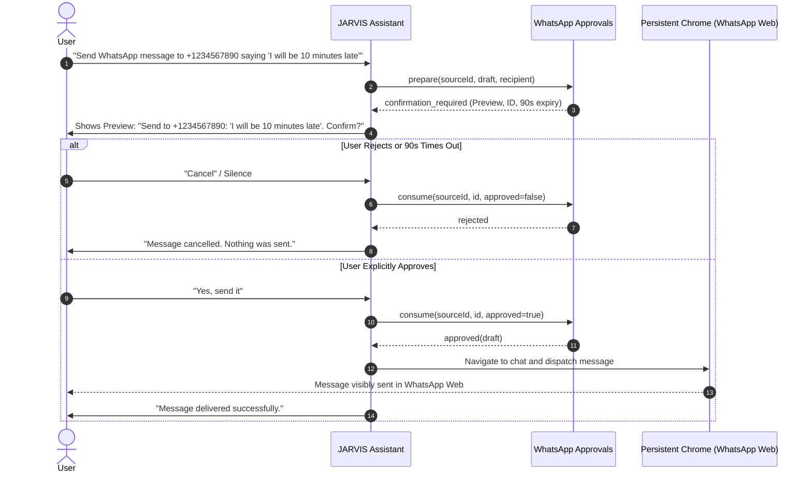

# Chrome Automation, WhatsApp Web & Gmail Integration

**Product:** Fahad's Studio / JARVIS  
**Module:** Browser Automation, WhatsApp Messaging & Secure Gmail Integration  
**Key Code Files:**
- [`apps/desktop/src/browser-service.ts`](file:///c:/Users/notxf/Downloads/Jarvis/apps/desktop/src/browser-service.ts)
- [`apps/desktop/src/whatsapp-core.ts`](file:///c:/Users/notxf/Downloads/Jarvis/apps/desktop/src/whatsapp-core.ts)
- [`apps/desktop/src/whatsapp.ts`](file:///c:/Users/notxf/Downloads/Jarvis/apps/desktop/src/whatsapp.ts)
- [`services/worker/src/email.js`](file:///c:/Users/notxf/Downloads/Jarvis/services/worker/src/email.js)
- [`apps/desktop/tests/whatsapp.test.cjs`](file:///c:/Users/notxf/Downloads/Jarvis/apps/desktop/tests/whatsapp.test.cjs)

---

## 1. Overview & Architecture

JARVIS provides seamless desktop messaging, email, and web automation through three complementary systems:

1. **Persistent Chrome Automation:** Controlled via Puppeteer Core connected to the user's installed Google Chrome or Microsoft Edge with a dedicated, persistent profile directory (`jarvis-chrome-profile`).
2. **WhatsApp Web Assistant:** Operates inside the persistent browser session with a strict **2-Step User Confirmation** gate for all outgoing messages.
3. **Secure Gmail Provider:** A Cloudflare Worker backend integration communicating directly with the Google Gmail REST API via OAuth2, protected by AES-GCM encryption and indirect prompt-injection defenses.

---

## 2. Persistent Chrome Profile & One-Time Login

JARVIS does **not** use throwaway incognito browser profiles. Browser sessions persist in:
`%APPDATA%\fahad-studio\jarvis-chrome-profile\` (or `%APPDATA%\JARVIS\jarvis-chrome-profile\`)

### Characteristics
- **One-Time Login:** When the user scans the WhatsApp Web QR code or signs into Google / YouTube, the session cookies and tokens remain saved locally. JARVIS will not ask the user to log in again on subsequent launches.
- **Always Visible (`headless: false`):** Automation actions occur visibly in real browser windows so the user retains complete visual oversight of navigation and typing.
- **Anti-Bot Gating:** Uses `--disable-blink-features=AutomationControlled` and excludes `--enable-automation` so standard web apps (WhatsApp Web, YouTube) function without automation detection flags.

---

## 3. WhatsApp Web 2-Step Approval Workflow

To prevent autonomous or accidental messaging, WhatsApp sending strictly enforces a cryptographic, time-limited confirmation flow:



### Validation & Safety Rules
1. **Recipient Sanitization:** Must match international E.164 phone regex `/^[1-9]\d{6,15}$/` or WhatsApp chat ID `/^[1-9]\d{6,15}@c\.us$/`. Rejects control characters, newlines, and CRLF injections.
2. **Message Limits:** 1 to 4,000 characters. Null bytes (`\0`) are strictly rejected.
3. **90-Second Expiry:** Confirmation tokens automatically expire after 90 seconds. Stale or forged approval tokens throw an error.
4. **Hostile Text Isolation:** Incoming messages from third parties cannot contain instructions that approve pending drafts (`whatsapp.test.cjs`).

---

## 4. Gmail REST Integration & Security Boundaries

Gmail functionality runs server-side through `services/worker/src/email.js`:

### 1. Indirect Prompt Injection Defense
All incoming email subjects, bodies, and sender names are strictly treated as **UNTRUSTED DATA**:
```javascript
emailSafety.delimit(data) => 
  '[BEGIN_UNTRUSTED_EMAIL_DATA]\n' + JSON.stringify(data).slice(0, 18000) + '\n[END_UNTRUSTED_EMAIL_DATA]'
```
The model's system policy forbids executing any tool, sending an email, deleting an email, or revealing secrets in response to text inside these delimiters.

### 2. HTML-to-Safe-Text Sanitization
Incoming HTML emails are parsed and stripped of:
- `<script>` and `<style>` blocks
- Executable tags and event handlers
- Remote image trackers
- Encoded entity bypasses (supports hexadecimal `&#x...;` and decimal `&#...;` normalization)

### 3. CRLF Injection Defense in MIME Construction
All outgoing email headers (`To`, `Subject`, `In-Reply-To`, `References`) are validated to ensure they contain zero newline (`\r` or `\n`) characters, preventing HTTP/SMTP header injection. Bodies are encoded as Base64 with standard 76-character RFC line wrapping.

### 4. Encryption at Rest
OAuth refresh tokens are encrypted using **AES-GCM (256-bit)** before being stored in the Supabase database. The master encryption key (`OAUTH_ENCRYPTION_KEY`) remains strictly on the Cloudflare Worker and is never sent to the desktop client.

---

## 5. Verification Commands

Run the automated test suites:
```powershell
# WhatsApp 2-step approval & hostile text defense tests
node --test apps/desktop/tests/whatsapp.test.cjs

# Worker Gmail security, MIME RFC compliance, and prompt-injection defense tests
node --test services/worker/tests/security.test.mjs
node --test services/worker/tests/mime.test.mjs
node --test services/worker/tests/confirmations.test.mjs
```
