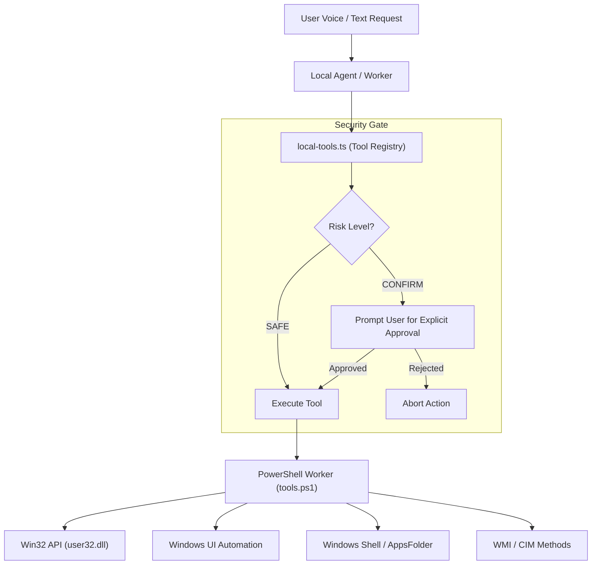

# Desktop Tool Automation & Native Windows Integration

**Product:** Fahad's Studio / JARVIS  
**Module:** Windows Automation, Native Tools & Process Control  
**Key Code Files:**
- [`apps/desktop/scripts/tools.ps1`](file:///c:/Users/notxf/Downloads/Jarvis/apps/desktop/scripts/tools.ps1)
- [`apps/desktop/src/local-tools.ts`](file:///c:/Users/notxf/Downloads/Jarvis/apps/desktop/src/local-tools.ts)
- [`apps/desktop/src/tool-schemas.ts`](file:///c:/Users/notxf/Downloads/Jarvis/apps/desktop/src/tool-schemas.ts)
- [`apps/desktop/src/browser-service.ts`](file:///c:/Users/notxf/Downloads/Jarvis/apps/desktop/src/browser-service.ts)

---

## 1. Overview & Architecture

JARVIS integrates deeply with the Windows operating system using a two-tier architecture:

1. **Host Orchestration (Electron Main Process):**
   - Validates all tool inputs against Zod schemas.
   - Evaluates risk classification (`SAFE` vs `CONFIRM` vs `BLOCKED`).
   - Dispatches automation requests via a clean JSON-over-stdio pipe to a dedicated PowerShell worker.

2. **Native Execution (PowerShell & Win32 P/Invoke):**
   - Implements native Windows APIs via embedded C# (`NativeWindows`).
   - Directly manipulates window handles (`HWND`), process lifecycles, and monitor configurations.
   - Inspects and drives accessibility trees via `UIAutomationClient` without external drivers.



---

## 2. Security Model & Risk Levels

JARVIS strictly classifies every local tool into risk tiers to ensure autonomous operation never damages user data or interrupts critical workflows without consent:

| Level | Policy | Description |
|---|---|---|
| `SAFE` | Auto-Execute | Read-only operations, search, app launch, window focus, volume, brightness, website navigation. |
| `CONFIRM` | User Approval Required | Destructive, persistent, or privacy-sensitive actions: closing apps, moving/deleting files, sleeping PC, reading/writing clipboard, taking screenshots, UIAutomation clicks. |
| `BLOCKED` | Denied | Arbitrary shell script execution, privilege elevation, raw registry tampering, or tampering with Windows system files. |

---

## 3. Tool Catalog & Specifications

### 3.1 Application Management

| Tool | Risk | Description |
|---|---|---|
| `list_installed_apps` | `SAFE` | Enumerates installed Start Menu programs, `.lnk` shortcuts, and UWP packages (`Get-StartApps`). |
| `open_app` | `SAFE` | Launches an application by name or fuzzy Levenshtein match (e.g. *"Calculator"*, *"Notepad"*, *"Chrome"*, *"VS Code"*). Brings window to foreground. |
| `focus_app` | `SAFE` | Brings an already running application window to the foreground by PID or process name. |
| `list_running_apps` | `SAFE` | Lists all visible top-level windows with active `MainWindowHandle`. |
| `close_app` | `CONFIRM` | Gracefully requests application shutdown via `CloseMainWindow()`, falling back to `Kill()` if unresponsive. |

### 3.2 Window & Display Control

| Tool | Risk | Description |
|---|---|---|
| `window_control` | `SAFE` | Actions: `minimize`, `maximize`, `restore`, `close`, `focus`, `left` (half-screen snap), `right` (half-screen snap), `monitor_next` (moves window to secondary monitor), and `minimize_all` (show desktop). |
| `open_settings` | `SAFE` | Launches specific Windows Settings pages via `ms-settings:` URIs (e.g., `sound`, `display`, `network`, `bluetooth`, `windowsupdate`). |
| `screen_brightness` | `SAFE` | Sets primary display brightness (0–100%) via WMI `WmiMonitorBrightnessMethods`. |
| `dark_mode` | `SAFE` | Toggles Windows light/dark theme in `HKCU:\Software\Microsoft\Windows\CurrentVersion\Themes\Personalize`. |

### 3.3 System & Audio Operations

| Tool | Risk | Description |
|---|---|---|
| `system_volume` | `SAFE` | Adjusts master volume (`up`, `down`, `mute`) using Windows virtual media keys (`keybd_event` VK_VOLUME_UP/DOWN/MUTE). |
| `system_radio` | `CONFIRM` | Toggles Wi-Fi adapter or opens Bluetooth/Airplane mode settings. Enforces that Wi-Fi adapter changes require Administrator rights. |
| `lock_screen` | `CONFIRM` | Locks the Windows workstation via `rundll32.exe user32.dll,LockWorkStation`. |
| `sleep_pc` | `CONFIRM` | Puts the computer into sleep/suspend mode via `powrprof.dll,SetSuspendState`. |

### 3.4 Filesystem Operations

| Tool | Risk | Description |
|---|---|---|
| `open_folder` | `SAFE` | Opens a local directory in File Explorer (`explorer.exe <path>`). |
| `find_file` | `SAFE` | Searches files recursively starting from `MyDocuments` or a specified root folder. Truncates output to 30 matches. |
| `open_file` | `SAFE` | Validates file existence and launches it with the registered Windows default handler. |
| `move_file` | `CONFIRM` | Safely moves a file from source path to destination path. |
| `delete_file` | `CONFIRM` | **Safe Recycling:** Uses `Microsoft.VisualBasic.FileIO.FileSystem.DeleteFile` with `SendToRecycleBin`, ensuring deleted files can be recovered from the Windows Recycle Bin. |

### 3.5 Clipboard & Screen Capture

| Tool | Risk | Description |
|---|---|---|
| `clipboard_read` | `CONFIRM` | Reads the current text content of the Windows system clipboard. |
| `clipboard_write` | `CONFIRM` | Copies text to the Windows system clipboard. |
| `screenshot` | `CONFIRM` | Captures the virtual desktop and saves a timestamped PNG file directly to `Pictures\Jarvis-YYYYMMDD-HHmmss.png`. |

### 3.6 Windows UI Automation (Accessibility Driver)

| Tool | Risk | Description |
|---|---|---|
| `ui_inspect` | `CONFIRM` | Inspects the UI Automation element tree of a target window up to depth 6, reporting control names, `AutomationId`s, control types (Button, Edit, CheckBox), and states. |
| `ui_automation` | `CONFIRM` | Drives native UI controls without mouse clicks using UIAutomation patterns (`InvokePattern` to click, `TogglePattern` to check, `ValuePattern` to type). Validates `expectedName` before clicking to prevent mis-clicks. |

---

## 4. Win32 Interoperability Layer

`tools.ps1` compiles an in-memory C# interop helper `NativeWindows` on demand using `Add-Type`:

```csharp
public class NativeWindows {
    [DllImport("user32.dll")] public static extern bool ShowWindow(IntPtr h, int cmd);
    [DllImport("user32.dll")] public static extern bool SetForegroundWindow(IntPtr h);
    [DllImport("user32.dll")] public static extern bool GetWindowRect(IntPtr h, out RECT r);
    [DllImport("user32.dll")] public static extern bool MoveWindow(IntPtr h, int x, int y, int w, int hgt, bool repaint);
    [DllImport("user32.dll")] public static extern IntPtr MonitorFromWindow(IntPtr hwnd, uint flags);
    [DllImport("user32.dll")] public static extern void keybd_event(byte key, byte scan, int flags, UIntPtr info);
}
```

This guarantees accurate window positioning, monitor traversal, and foreground focusing even when target processes are minimized or hidden.

---

## 5. Verification & Testing

Native tools are tested using PowerShell and Node.js:
- Running `tools.ps1` with JSON input `{"name": "list_installed_apps", "args": {}}` enumerates real Windows applications.
- Running `{"name": "open_app", "args": {"name": "calc"}}` launches the Windows Calculator and brings it to the foreground.
- Running `{"name": "window_control", "args": {"name": "calc", "action": "minimize"}}` minimizes the Calculator window.
