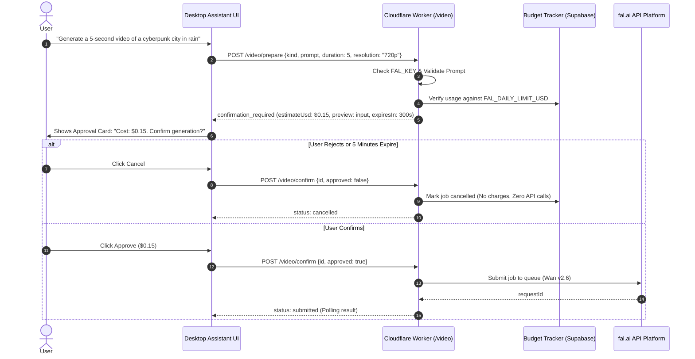

# fal.ai Video Engine Setup & Cost Controls

**Product:** Fahad's Studio / JARVIS  
**Module:** Cloud Generative Video Engine & Cost Guardrails  
**Key Code Files:**
- [`services/worker/src/video.js`](file:///c:/Users/notxf/Downloads/Jarvis/services/worker/src/video.js)
- [`services/worker/src/video-models.js`](file:///c:/Users/notxf/Downloads/Jarvis/services/worker/src/video-models.js)
- [`services/worker/tests/fal-adapter.test.mjs`](file:///c:/Users/notxf/Downloads/Jarvis/services/worker/tests/fal-adapter.test.mjs)
- [`services/worker/tests/confirmations.test.mjs`](file:///c:/Users/notxf/Downloads/Jarvis/services/worker/tests/confirmations.test.mjs)

---

## 1. Overview & Architecture

JARVIS includes support for generative AI video rendering through **fal.ai** (e.g., Wan v2.6, Fast SDXL, and Video-to-Video models). 

Because cloud video generation incurs real API fees, JARVIS implements a strict **Zero-Cost Safety Guarantee**:
- Free local editing via FFmpeg is always the default.
- Cloud video generation is completely disabled unless the user explicitly provides a `FAL_KEY`.
- No paid API call can ever execute during prompt previews or edit planning.
- All paid generations require a 2-step confirmation with a strict daily USD spending limit.



---

## 2. Configuration & Environment Variables

Configure the following environment variables in `services/worker/.dev.vars` (for local development) or Cloudflare Worker Secrets (for production):

| Variable | Required | Default | Description |
|---|---|---|---|
| `FAL_KEY` | Optional | *Unset* | API key from [fal.ai Dashboard](https://fal.ai/dashboard/keys). If unset, paid video generation is disabled and returns 503 with helpful setup instructions. |
| `FAL_DAILY_LIMIT_USD` | Optional | `5` | Hard spending ceiling in USD per 24-hour UTC day (e.g. `5` for \$5/day, `2` for \$2/day, or `0` to block all paid generations). |

---

## 3. Cost Guardrails & Safety Guarantees

### 1. Zero Paid Calls During Preview
The `/video/prepare` endpoint only calculates duration, resolution, and estimated price from `video-models.js`. It records a pending job row in Supabase and returns a preview to the user. **Zero network calls to fal.ai are made.**

### 2. Atomic 5-Minute Confirmation Window
Confirmation tokens expire after 300 seconds (5 minutes). A job cannot be confirmed twice, preventing double-billing on rapid clicks or network retries.

### 3. Hard Daily Budget Ceiling
Before any job can be prepared, the worker queries `jarvis_video_usage` for the current UTC day. If `total_spent + estimated_cost > FAL_DAILY_LIMIT_USD`, the request is immediately rejected with HTTP 403:
```json
{
  "error": "Daily paid generation budget exceeded",
  "estimateUsd": 0.15,
  "dailyLimitUsd": 5.0
}
```

### 4. Zero-Dollar Lockdown (`FAL_DAILY_LIMIT_USD=0`)
Setting `FAL_DAILY_LIMIT_USD=0` completely blocks all paid generation preparation, allowing administrators to safely prevent any billing while keeping the rest of the application functional.

---

## 4. Diagnostics & Testing

The `/video/diagnostics` endpoint allows inspecting the provider status without making external network calls:

```powershell
# Run the automated fal.ai adapter test suite
node --test services/worker/tests/fal-adapter.test.mjs

# Run confirmation and budget security tests
node --test services/worker/tests/confirmations.test.mjs
node --test services/worker/tests/security.test.mjs
```

### Verified Test Cases:
- ✔ `FalEngine` throws explicit configuration error when `FAL_KEY` is missing
- ✔ `FalEngine` submits text-to-video job using mocked client without live paid API call
- ✔ `FalEngine` propagates provider errors, timeouts, and rate limits gracefully
- ✔ `/video/diagnostics` endpoint reports configuration status truthfully without network calls
- ✔ Paid fal generation never submits during preview and stays off if missing `FAL_KEY`
- ✔ A zero-dollar FAL daily budget blocks preparation instead of falling back to default
