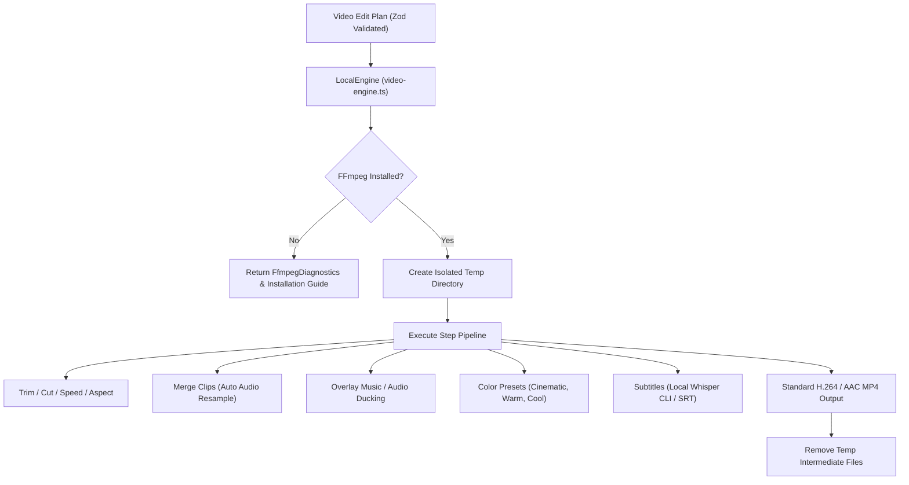

# Local FFmpeg Video Production Pipeline

**Product:** Fahad's Studio / JARVIS  
**Module:** Local Video Editing, Transcoding & Subtitle Generation  
**Key Code Files:**
- [`apps/desktop/src/video-engine.ts`](file:///c:/Users/notxf/Downloads/Jarvis/apps/desktop/src/video-engine.ts)
- [`apps/desktop/tests/video-diagnostics.test.cjs`](file:///c:/Users/notxf/Downloads/Jarvis/apps/desktop/tests/video-diagnostics.test.cjs)
- [`apps/desktop/tests/video-smoke.test.cjs`](file:///c:/Users/notxf/Downloads/Jarvis/apps/desktop/tests/video-smoke.test.cjs)

---

## 1. Overview & Architecture

JARVIS includes a high-performance, completely offline local video production pipeline driven by FFmpeg and Whisper. It runs on the user's Windows CPU/GPU without cloud costs or external API calls.



---

## 2. Supported Edit Operations & Presets

Each edit plan is validated by `videoEditSchema` and supports sequential chaining up to 30 operations:

### 1. Aspect Ratio Conversion (`aspect`)
- Automatically scales and crops to target format:
  - `16:9`: Horizontal widescreen (YouTube, Desktop video)
  - `9:16`: Vertical mobile video (Instagram Reels, TikTok, YouTube Shorts)
  - `1:1`: Square (Instagram Feed)
  - `4:5`: Portrait video

### 2. Multi-Clip Merging (`merge`)
- Concatenates up to 15 video files in sequence.
- Normalizes all clips to standard 1280x720 30fps with aspect-ratio letterboxing / pillarboxing.
- Handles clips with missing audio by generating clean synchronized silence (`anullsrc`) to prevent desync.
- Resamples audio tracks to 48kHz stereo AAC.

### 3. Audio & Music Mixing (`music`)
- Adds background music tracks with volume normalization (`volume: 0.0 - 2.0`, default 0.25).
- Blends background music over original speech audio without overwriting primary sound.

### 4. Cinematic Color Filters (`filter`)
Applies color grading presets:
- `cinematic`: Contrast 1.08, saturation 0.90, brightness -0.02
- `warm`: Saturation 1.12, gamma red 1.06, gamma blue 0.97
- `cool`: Saturation 1.06, gamma blue 1.08, gamma red 0.97
- `vintage`: Contrast 0.93, saturation 0.68 with vintage curves
- `grayscale`: Saturation 0
- `vivid`: Contrast 1.06, saturation 1.30

### 5. Automated Subtitles (`subtitles`)
- Integrates with local `whisper-cli` or custom SRT files to burn open-captions directly into video frames.

---

## 3. Environment Diagnostics & Setup Guide

The video engine includes built-in diagnostics via `diagnoseFfmpegEnvironment()`:

```typescript
export interface FfmpegDiagnostics {
  ffmpegInstalled: boolean;
  ffprobeInstalled: boolean;
  ffmpegPath: string;
  ffprobePath: string;
  ffmpegVersion?: string;
  codecs: {
    h264: boolean;
    aac: boolean;
  };
  installationGuidance?: string;
}
```

### Truthful Missing Binary Reporting
If FFmpeg or FFprobe is not detected on the host system:
- The engine throws a clear, descriptive error containing setup instructions.
- It will **never** fake a successful video render.

### How to Install FFmpeg on Windows:
1. **Option A (Recommended — Windows Package Manager):**
   Open PowerShell as Administrator and run:
   ```powershell
   winget install Gyan.FFmpeg
   ```
2. **Option B (Manual Download):**
   - Download the latest `ffmpeg-release-essentials.zip` from [Gyan.dev FFmpeg Builds](https://www.gyan.dev/ffmpeg/builds/).
   - Extract to `C:\ffmpeg`.
   - Add `C:\ffmpeg\bin` to your System `PATH` environment variable.
3. **Option C (Custom Path Override):**
   If you have FFmpeg installed in a custom location, configure environment variables:
   ```powershell
   $env:IRFAN_FFMPEG_PATH = "C:\tools\ffmpeg\bin\ffmpeg.exe"
   $env:IRFAN_FFPROBE_PATH = "C:\tools\ffmpeg\bin\ffprobe.exe"
   ```

---

## 4. Verification & Testing

Run the automated tests:
```powershell
# Diagnostic & Schema Validation Tests (pass offline without FFmpeg)
node --test apps/desktop/tests/video-diagnostics.test.cjs

# End-to-End Transcoding Smoke Test (runs when FFmpeg is installed in PATH)
node --test apps/desktop/tests/video-smoke.test.cjs
```
