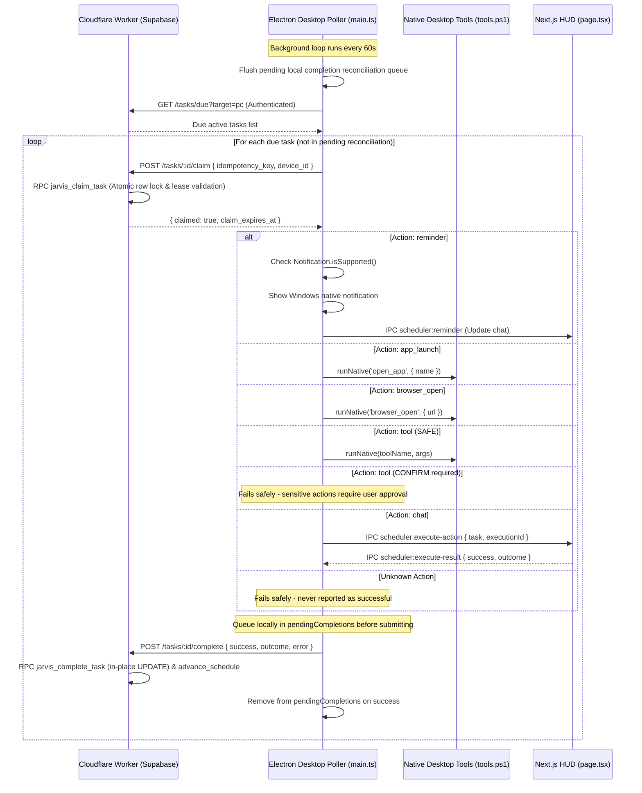

# Persistent Task Scheduling & Desktop Automation
**Product:** Fahad's Studio / JARVIS  
**Module:** Task Scheduler, Atomic Claiming, Desktop Poller & Execution Safety  
**Last Updated:** November 4, 2026 (Third-Round Stabilization & Bug Fix Pass)

---

## 1. Overview & Architecture

JARVIS includes a production-grade automated scheduling engine capable of executing reminders, native application launches, authorized tools, and browser navigation across Windows desktop and cloud environments.

---

## 2. Database Schema & Atomic Claiming Migration

The additive migration [`supabase/migrations/20261104_scheduler_claim_atomic.sql`](file:///c:/Users/notxf/Downloads/Jarvis/supabase/migrations/20261104_scheduler_claim_atomic.sql) extends the database:

### Schema Additions:
1. `public.jarvis_task_history`:
   - `idempotency_key text`: Unique attempt execution key (`${runId}:attempt:${attemptNumber}`).
   - `run_id text`: Logical run identity identifying the occurrence (`${taskId}:${scheduledIso}`).
   - `attempt_id text`: Distinct attempt identity.
   - `attempt_number integer`: 0-indexed attempt count.
   - Unique index: `CREATE UNIQUE INDEX jarvis_task_history_idempotency_idx ON jarvis_task_history (task_id, idempotency_key) WHERE idempotency_key IS NOT NULL;`
   - Expanded CHECK constraint: `CHECK (status IN ('claimed', 'running', 'completed', 'failed', 'skipped', 'cancelled', 'missed', 'retrying', 'stale'))`
2. `public.jarvis_scheduled_tasks`:
   - `claimed_at timestamptz`: Timestamp when lease was granted.
   - `claim_expires_at timestamptz`: Lease deadline (default 300 seconds). Prevents tasks from being locked permanently if a desktop app crashes mid-execution.
   - `claimed_by text`: Device identifier (`'pc'`).
   - `current_run_id text`: Logical occurrence currently claimed.
   - `current_attempt_id text`: Attempt identity currently claimed.

### Atomic PostgreSQL Functions:
- **`public.jarvis_claim_task(p_task_id, p_device_id, p_idempotency_key, p_lease_seconds, p_run_id, p_attempt_id)`**:
  - Uses `FOR UPDATE` row-level locking on `jarvis_scheduled_tasks` first (consistent locking order).
  - **Exhaustive Validations:**
    1. `task_not_found`: Verifies task exists.
    2. `task_not_active`: Rejects paused/completed tasks.
    3. `already_completed`: Verifies this logical `run_id` has not already completed. **A successful occurrence never executes twice.**
    4. `max_retries_exceeded`: If retry count reached `max_retries`, marks task `failed` and rejects claim.
    5. `task_not_due`: Rejects future tasks where `next_run_at > now() + interval '10 seconds'`.
    6. `target_mismatch`: Verifies `execution_target IN ('any', p_device_id)`.
    7. `already_claimed`: Identical attempt key by same device with active unexpired lease returns `{ claimed: true, already_claimed: true }` idempotently.
    8. `lease_active`: Rejects if an unexpired lease exists on another device/attempt (`claim_expires_at > now()`). Expired leases (`<= now()`) are safely recovered.
  - Inserts single execution history row with `status = 'claimed'`, `run_id`, `attempt_id`, and `started_at = now()`.
  - Sets lease columns on `jarvis_scheduled_tasks` and returns `{ claimed: true, task_id, run_id, attempt_id, claim_expires_at }`.
- **`public.jarvis_complete_task(p_task_id, p_device_id, p_idempotency_key, p_success, p_outcome, p_error, p_run_id, p_attempt_id)`**:
  - Consistent row lock ordering: `jarvis_scheduled_tasks` FOR UPDATE, then `jarvis_task_history` FOR UPDATE.
  - Idempotent on repeated calls (`already_completed: true`).
  - **Strict Ownership & Stale Execution Prevention (Section 3.B):**
    - `device_mismatch`: Rejects completion if claiming device does not match (`claimed_by <> p_device_id`).
    - `lease_expired`: If the claiming device's lease expired before completion, marks attempt `stale` and returns 409 Conflict without modifying task recurrence or active claims.
    - `stale_execution`: If another attempt was claimed (`current_attempt_id <> attempt_id`), marks old attempt `stale` and returns 409 Conflict without clearing the newer lease or advancing the schedule.
  - **Single-Row History Update:** Performs an in-place `UPDATE` on `jarvis_task_history` for this attempt.
  - Clears lease state (`claimed_by = NULL, claim_expires_at = NULL, current_run_id = NULL, current_attempt_id = NULL`).
  - **On Success:** Resets `retry_count = 0` and calls `public.jarvis_advance_schedule(p_task_id)` as the single authority for recurrence advancement.
  - **On Failure:** Increments `retry_count`. If `retry_count >= max_retries`, marks task `failed`. If under max retries, calculates exponential backoff (`30s * 2^(retry-1)` up to 300s), sets `next_run_at = now + backoff`, and returns `status: 'retrying'`.

---

## 3. Desktop Durable Outbox (`apps/desktop/src/scheduler-outbox.ts`)

### Reliability Features:
1. **Durable File Persistence (`DurableOutbox`):**
   - File path: `path.join(app.getPath('userData'), 'scheduler-outbox.json')`.
   - Writes atomically via temp-file rename (`.tmp` -> target).
   - Persists completion records to disk **BEFORE attempting network delivery**.
   - On application startup, recovers pending records and flushes to worker.
   - Records removed from disk ONLY upon explicit server confirmation (`res.ok && compData.ok === true`).
   - Exponential retry backoff on delivery failure: `2000 * 2^(attempts-1)` ms up to 300,000 ms.
   - Local actions are NEVER rerun merely because reporting completion failed (`outbox.has(attemptId)` skips execution).
   - Corrupted or partial JSON files are quarantined to `.corrupted.<timestamp>` and outbox starts fresh without crashing.
2. **In-Flight Guard (`isPolling`):** Ensures overlapping poll cycles cannot execute concurrently if an action takes longer than 60 seconds.
3. **Two-Tier Identity:**
   - `run_id = `${task.id}:${runTs}``
   - `attempt_id = `${runId}:attempt:${task.retry_count || 0}``
4. **Worker HTTP Response Validation:**
   - Inspects both HTTP status (`res.ok`) and response body (`compData?.ok === true`).
   - Server returns 400, 404, 409, or 502 on failure; desktop records failure and applies backoff.
5. **Notification Verification:** Checks `Notification.isSupported()` before reporting reminder success.
6. **Strict Action Registry:** `reminder`, `app_launch`, `browser_open`, `tool`, `chat`. Unknown actions fail safely.
7. **Safety Policy for Sensitive Tools:** Dangerous tools (`delete_file`, `move_file`, `close_app`, `ui_automation`) refuse silent background execution.
1. **In-Flight Guard (`isPolling`):** Ensures overlapping poll cycles cannot execute concurrently if an action takes longer than 60 seconds.
2. **Stable Execution IDs:** Formed from `taskId + ':' + scheduledTimestamp`, guaranteeing identical execution keys across re-polls within the same window.
3. **Local Completion Reconciliation Queue (`pendingCompletions`):**
   - Keeps track of in-flight and completed tasks in an in-memory map.
   - If a network drop occurs when reporting completion to the worker, the completion payload is queued locally.
   - Tasks with pending completions are skipped during subsequent polls so actions are never re-executed.
   - Every polling loop flushes all pending completions to the worker before polling for new tasks.
4. **Notification Verification:** Checks `Notification.isSupported()` and wraps notification display in `try/catch`. If notifications are unsupported or throw, `success = false` is reported.
5. **Strict Action Registry:**
   - Supported: `reminder`, `app_launch`, `browser_open`, `tool`, `chat`.
   - Unknown actions **fail safely** and are never falsely marked as successful reminders.
6. **Safety Policy for Sensitive Tools:**
   - Safe tools (e.g., volume control, brightness, opening apps) execute directly.
   - Sensitive tools (`delete_file`, `move_file`, `close_app`, `ui_automation`) refuse silent background execution and fail with `"requires interactive confirmation"`.
7. **Full IPC Correlation:**
   - Sends `scheduler:execute-action` to active UI windows with a 12-second timeout.
   - Receives `scheduler:execute-result` to verify renderer execution before completing the task.
