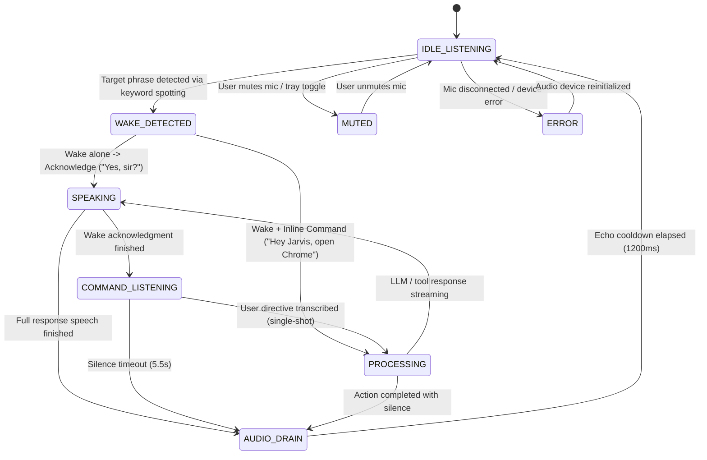

# Voice & Wake-Word Activation Pipeline — JARVIS
**Product:** Fahad's Studio / JARVIS  
**Module:** Wake-Word Detection, Keyword Spotting, Audio State Machine & Echo Suppression  
**Last Updated:** November 4, 2026 (Third-Round Stabilization & Bug Fix Pass)

---

## 1. Overview & Architecture

JARVIS uses a hybrid acoustic pipeline designed specifically for Windows desktop operation.

The primary engineering challenges in desktop voice assistants are:
1. **Self-response loop prevention:** The assistant hearing its own synthesized voice through laptop or desktop speakers and triggering another wake or command cycle.
2. **Strict phrase matching:** Ensuring only the user's explicitly configured wake phrase activates the assistant, with no unconfigured hardcoded aliases.
3. **Single-shot command execution:** Ensuring coordinated text recognition and audio recording never submit the same user command twice.
4. **Single-gate cooldown enforcement:** Preventing double cooldown evaluations from suppressing genuine wake events while reliably rejecting acoustic bounce.

The pipeline solves this through a dedicated **8-State Audio State Machine**, strict **acoustic turn isolation**, **single-shot turn management**, a **single-gate cooldown manager**, and an **acoustic echo shield**.

---

## 2. Keyword Spotting & Recognition Engine

### Recognition Layer & Honest Capabilities
- **Engine:** Continuous transcript-based keyword spotting via the browser `SpeechRecognition` API (`webkitSpeechRecognition` in Chromium / Electron).
- **Honest Connectivity Model:** The Web Speech API is a browser-level speech recognition system. In Electron on Windows, Chromium utilizes either local OS speech recognition (Windows Speech Recognition) or cloud services. **It is NOT guaranteed 100% offline.**
- **Push-to-Talk Deterministic Fallback:** At all times across Windows, the user can press **`Alt+M`** or **`Ctrl+Space`** to instantly restore the window and capture audio without relying on the continuous speech recognition engine.

### Strict Phrase Matching (`matchWakePhrase`)
- **Configured Target:** The detector matches ONLY the phrase configured by the user (default: `"Hey Jarvis"`).
- **No Unconfigured Hardcoded Aliases:** If the user sets `"Computer"`, speaking `"Hey Jarvis"` or `"Jarvis"` will NOT activate the assistant.
- **Word-Boundary Precision:** Matches must start and end on word boundaries. Substrings like `"computerized"` will never trigger `"Computer"`, and `"jarvises"` will never trigger `"Jarvis"`.
- **Confidence Gate:** When speech alternatives supply confidence scores, minimum thresholds (0.40 normal, 0.15 high sensitivity) are enforced.
- **Inline Directive Extraction:** When a user speaks a wake phrase and directive together (e.g., *"Hey Jarvis what time is it"*), `matchWakePhrase` extracts `"what time is it"` as `commandAfter` and immediately executes it, skipping the redundant greeting round-trip.

### Single-Gate Cooldown Architecture
- **Single Authority:** `triggerWakeDetected(inlineCommand: string): boolean` is the sole authority for recording `lastWakeTime` and evaluating the 2500ms cooldown window.
- **Elimination of Suppression Bug:** Speech recognition `onresult` checks if the detector is within cooldown before stopping recognition, but does not overwrite `this.lastWakeTime`. This eliminates the double-check race condition that previously blocked legitimate wake events.
- **Deterministic Interface:** `triggerWakeDetected` returns `true` when the activation is accepted and `false` when suppressed by cooldown.
- **Full Recognition-to-Callback Testing:** Verified via end-to-end integration tests (`wake-detector.test.mjs`) driving mock `SpeechRecognition` instances through event dispatch, callback execution, cooldown rejection, cooldown expiration, and phrase reconfiguration.

---

## 3. Single-Shot Command Turn Resolution (Fix 2)

To capture voice directives reliably, JARVIS coordinates text recognition with an audio recording fallback:

1. **Turn ID:** Each activation increments `currentTurnId`.
2. **Text Priority:** The browser's speech recognition engine attempts fast text transcription.
3. **Single-Shot Resolution:**
   - If text recognition returns a non-empty command transcript:
     - The turn is marked `turnResolved = true`.
     - The recorded audio chunks are immediately discarded (`commandChunks = []`).
     - `onCommandText` fires once.
     - `onCommandCaptured` is **NEVER** called for this turn.
   - If text recognition errors or yields silence:
     - The recorded audio blob is submitted to `onCommandCaptured` exactly once for backend STT processing.
4. **Cancellation:** Calling `cancelCommandCapture()`, `suspend()`, or `stop()` sets `turnResolved = true` and flushes all audio chunks, preventing stale callbacks.

---

## 4. Audio State Machine & Echo Shield

The state machine (`apps/ui/lib/audio-state-machine.ts`) enforces strict single-state transitions:

| State | Microphone Capture | Wake Detection | Description |
|---|---|---|---|
| `IDLE_LISTENING` | Active | **Enabled** | Passive background monitoring for the configured wake phrase. |
| `WAKE_DETECTED` | Paused | Disabled | Transient activation state. Evaluates whether input contains an inline command. |
| `COMMAND_LISTENING` | Active | Disabled | Active speech directive window. Single-shot turn captures text or audio fallback. |
| `PROCESSING` | Suspended | Disabled | LLM reasoning or local tool execution is underway. |
| `SPEAKING` | Suspended | Disabled | Assistant synthesized audio (TTS) is playing. **Microphone is muted.** |
| `AUDIO_DRAIN` | Suspended | Disabled | 1200ms grace period after TTS finishes. Flushes residual speaker audio. |
| `MUTED` | Disabled | Disabled | Hardware microphone muted or user toggled mute in tray. |
| `ERROR` | Disabled | Disabled | Microphone disconnected or permission denied. |

---

## 5. Hardware Resilience, Device Switching & Loop Prevention

### Audio Hardware Device Change Detection
When users plug in, unplug, or switch audio hardware (e.g. connecting a Bluetooth headset or USB microphone), `OfflineWakeDetector` dynamically adapts without application restart:
1. **Device Change Listener:** Subscribes to `navigator.mediaDevices.addEventListener('devicechange')`.
2. **Re-enumeration & Safe Reset:** Debounces device changes (500ms), stops current recognition and media stream tracks cleanly, and re-invokes `getUserMedia({ audio: true })` to bind to the new default audio input device.
3. **Audio Track Disconnect Handler:** Monitors `track.onended` on all active audio tracks. If an unplug event abruptly terminates the media track, the detector transitions cleanly to a reconnecting state and attempts automatic reconnection with exponential backoff rather than throwing an uncaught exception.

### Multiple Recognition Loop Prevention
In long-running desktop sessions or after rapid sleep/wake cycles, multiple `SpeechRecognition` instances or concurrent loops could previously spawn:
- **Pre-emptive Teardown:** Every call to `startRecognition()` explicitly calls `this.stopRecognition()` first, ensuring any existing Chromium recognition instance is terminated and its event listeners unbound.
- **Single-Timer Cleanup:** Grace timers (`graceTimeout`), restart timers (`restartTimer`), and reconnection timers (`deviceReconnectTimer`) are cleared before creating new timers and on `stop()`.
- **Atomic State Transitions:** The detector tracks state transitions through its internal state machine (`idle`, `listening`, `capturing_command`, `suspended`, `api_unavailable`), preventing simultaneous wake processing and command capture.

